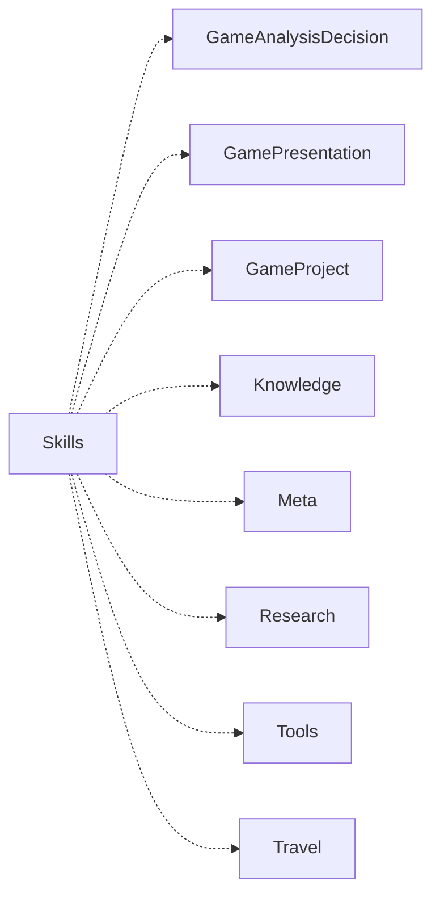

# Skills

2.2.0 contains 42 individually selectable methods.

[简体中文](README.md)

Select individual agent methods without enabling the whole library.

This repository is the independent publication authority for Skills. Start with the [domain guide](README.md) and the [module contract](module.json). Follow the listed runtime prerequisites. User projects, facts, accounts and runtime stay in user-owned locations. AWS and meta are optional collaboration and governance integrations.

```text
python .module/module_manager.py verify
python .module/module_manager.py related
python .module/module_manager.py audit --target <workspace> --modules <related-id>
python .module/module_manager.py fetch --target <workspace> --modules <related-id> --apply
```

Review existing workflows, ownership and interfaces before retrieval. The manager reuses a matching verified module and preserves existing directories and edits. Fetching a peer does not run its services or complete a business integration. See [cooperation](docs/module-cooperation.md) for handoff and recovery.

<!-- module-panorama:start -->


虚线表示可选协作。具体用途与接口见 module.json 和协作说明。 / Dashed edges indicate optional cooperation. See module.json and the cooperation guide.
<!-- module-panorama:end -->

The [AWS overview](https://github.com/ZhongTyler/AgentWorkSpace) presents the full module network. This module retains original third-party notices and the reviewed 1.30.0 source record. Independent module versioning starts at 2.0.0.

## 2.1.0 library update

Existing editing, interaction, evidence, research, runtime and workflow methods are updated. Select `game-change-audit` for scoped game reviews or `plain-language-zh` for reader-oriented editing. Install named skills using the existing selector. Package upgrades and installed client-skill upgrades are separate transactions.

## 2.2.0 candidate changes

Adds game-description-writing; updates UI feedback, production-state checks, layered artwork, optional explanatory media, candidate-service boundaries and standalone closure. 42 selectable skills; portfolio and flow-diagram drafts remain outside. See the [review](docs/2.2.0-review.md).

~~~mermaid
flowchart LR
  goal[Task and host authority] --> gap[Current capability gap]
  gap --> method[Selected Skill and references]
  method --> tool[Configured tool or direct work]
  tool --> review[Host validation and adoption]
  review --> feedback[Evidence to actual owner]
~~~

This is documented routing, not measured automatic selection. Tools remain optional. Installation checks establish packaging and recovery, not method effectiveness or long-term savings.

## Chinese reader catalog

See the [Chinese catalog](docs/skills.zh-CN.md) and per-skill README.zh-CN.md entries, generated from [one locale source](locales/zh-CN.json). Invocation IDs and original methods remain unchanged. External origins follow preserved provenance records. Run python scripts/render_zh_catalog.py to check generated reader fields.
